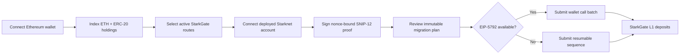

# Stark Crossing

Stark Crossing is a self-custodial Ethereum mainnet → Starknet mainnet migration dApp. It indexes an EVM wallet, keeps every active StarkGate ERC-20 route selected by default, proves control of the destination Starknet account with a nonce-bound SNIP-12 signature, and submits the exact approvals and deposits from the user's Ethereum wallet.

The v1 scope is deliberately narrow: native ETH and ERC-20 assets only. NFTs, swaps, unsupported tokens, smart-deposit strategies, and other source chains are out of scope.

## User flow



## Run locally

Requires Node.js 22+.

```bash
npm install
cp .env.example .env.local
npm run dev
```

Open [http://localhost:3000](http://localhost:3000). The fixture-backed demo is usable without credentials in development.

For a real wallet, set at least:

- `ALCHEMY_API_KEY`: server-side Alchemy Portfolio API and Ethereum RPC access.
- `STARKNET_RPC_URL`: Starknet mainnet RPC for deployment checks and signature verification.
- `NEXT_PUBLIC_WALLETCONNECT_PROJECT_ID`: optional for WalletConnect/mobile connections. Injected Rabby and MetaMask connections work without it.
- `DATABASE_URL`: PostgreSQL connection string. Development can use memory; production must use persistent storage.

`NEXT_PUBLIC_ENABLE_MAINNET_EXECUTION` is `false` by default. Leave it locked until the application has been exercised against forked mainnet state and independently security reviewed.

## Architecture

- Next.js 16, React 19, TypeScript, Wagmi/Viem, and RainbowKit for EVM wallet access.
- `@starknet-io/get-starknet-ui` and Starknet.js for Starknet Wallet Standard connections, typed-data signing, deployment checks, and account-contract signature verification.
- Alchemy's [Tokens By Wallet endpoint](https://www.alchemy.com/docs/data/portfolio-apis/portfolio-api-endpoints/portfolio-api-endpoints/get-tokens-by-address) supplies balances, metadata, and USD prices.
- The live [Starknet bridged-token registry](https://github.com/starknet-io/starknet-addresses) is the route allowlist. Entries marked `Deposit blocked` are excluded. Production fails closed when that registry is unavailable; a small bundled subset is available only in development or by explicit override.
- PostgreSQL stores full migration plans, action progress, expiring challenges, and replay-consumption state. Tables are created on first use. Production fails closed without `DATABASE_URL` unless an ephemeral preview explicitly opts into `ALLOW_IN_MEMORY_PERSISTENCE=true`.

The API never trusts submitted balances or transaction calldata. When a plan is built, the server re-reads balances and allowances from Ethereum, resolves contracts from the current StarkGate registry, obtains `estimateDepositFeeWei` onchain, and generates the calls itself.

## Migration safeguards

- Only active StarkGate ETH/ERC-20 routes can enter a plan. [StarkGate's protocol documentation](https://docs.starknet.io/learn/protocol/starkgate) describes the legacy and multi-bridge deposit ABIs used here.
- Unsupported and suspicious holdings remain visible but unselected. Eligible holdings are selected by default, with a one-click control for positions worth less than $1.
- Every insufficient ERC-20 allowance gets an exact approval. Tokens with an existing non-zero allowance get a zero-reset first for compatibility.
- Native ETH is deposited last. The plan retains the configured Ethereum gas reserve plus all quoted L1→L2 messaging fees.
- The destination must already be deployed on Starknet mainnet. Its account contract verifies a readable SNIP-12 signature bound to the source address, destination address, exact plan hash, random nonce, and 10-minute expiry.
- The source wallet still authorizes every Ethereum action. No backend key or custody account exists.
- Wallets advertising the EIP-5792 `atomic` capability receive `wallet_sendCalls` with `atomicRequired: false`; the returned batch is tracked with `wallet_getCallsStatus`. The [EIP-5792 specification](https://eips.ethereum.org/EIPS/eip-5792) explicitly permits non-atomic handling, so wallets without that capability use the persisted sequential fallback.
- Sequential progress is saved after submission and confirmation. On resume, an already-submitted transaction is waited on by hash and is not sent twice.

## Commands

```bash
npm run typecheck
npm run lint
npm test
npm run build
```

## Production checklist

Before enabling mainnet writes:

1. Use dedicated authenticated Ethereum and Starknet RPC endpoints, persistent PostgreSQL, and a real WalletConnect project ID.
2. Set `ALLOW_DEMO_MODE=false` and `ALLOW_STARKGATE_REGISTRY_FALLBACK=false`, rate-limit the API routes, and place the app behind a restrictive CSP and HTTPS-only edge configuration.
3. Validate the complete flow on an Ethereum mainnet fork with representative token behavior, including zero-reset approvals and batch partial failures.
4. Add monitoring for failed API calls, challenge replay attempts, EIP-5792 bundle states, Ethereum receipts, and the StarkGate L1→L2 deposit lifecycle.
5. Commission an independent application and smart-contract-integration security review. This repository invokes audited protocol contracts but is not itself audited.

## Known v1 limitations

- No ERC-721 or ERC-1155 support.
- No swap or alternative bridge path for assets absent from the StarkGate registry.
- USD values are estimates and can be missing or stale; they never determine an onchain amount.
- The selected ERC-20 amount is the wallet's full current balance. ETH is the full current balance minus messaging fees and the configured reserve.
- Stark Crossing tracks Ethereum transaction/batch confirmation and links to StarkGate activity; it does not yet persist `ACCEPTED_ON_L2` delivery status.
- A fixed reserve cannot guarantee future Ethereum gas costs. The final wallet confirmation remains authoritative.
- The in-memory development store is intentionally non-durable and unsuitable for multi-instance deployment.
